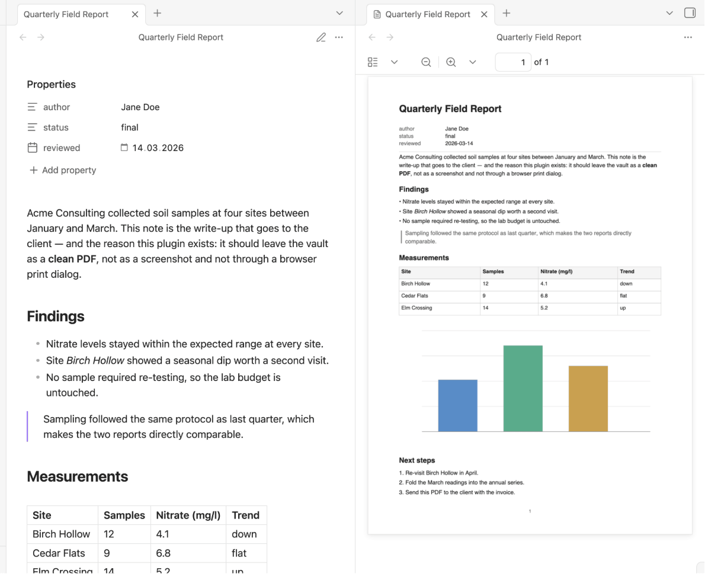
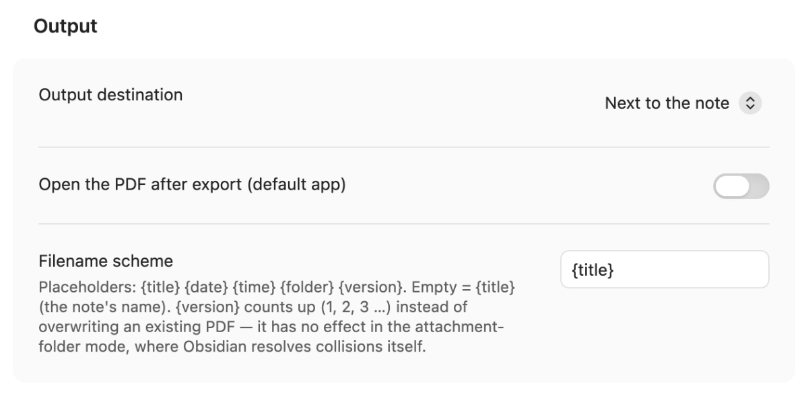
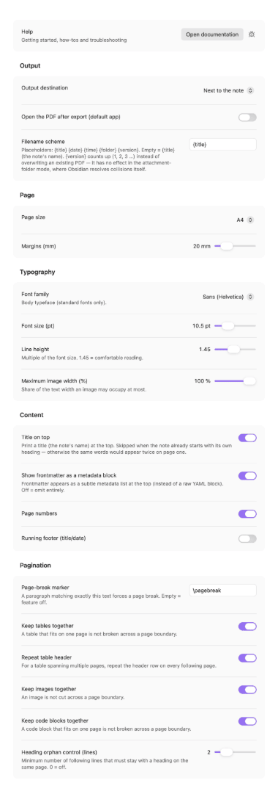
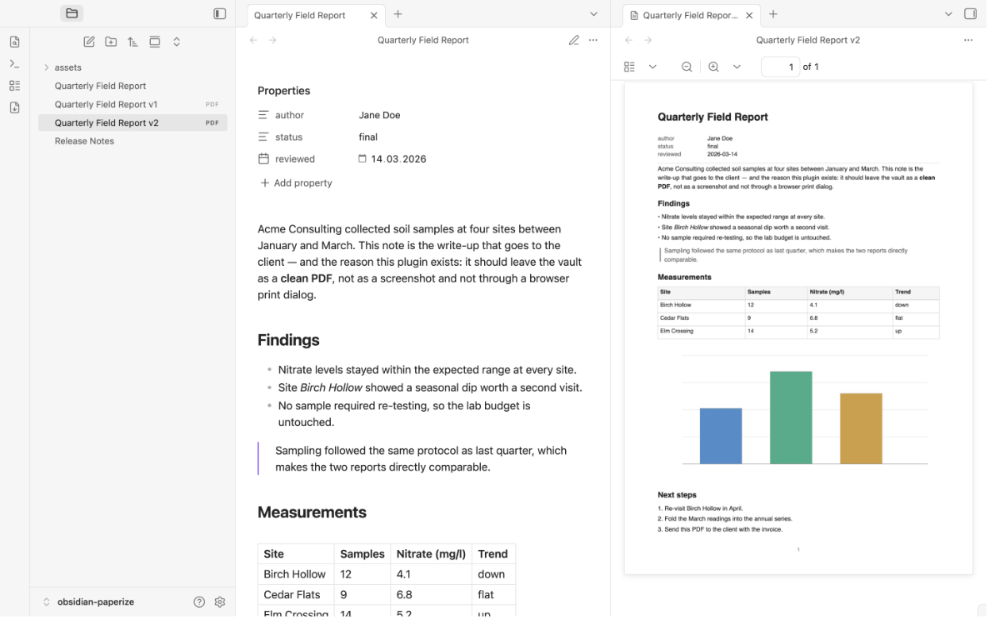
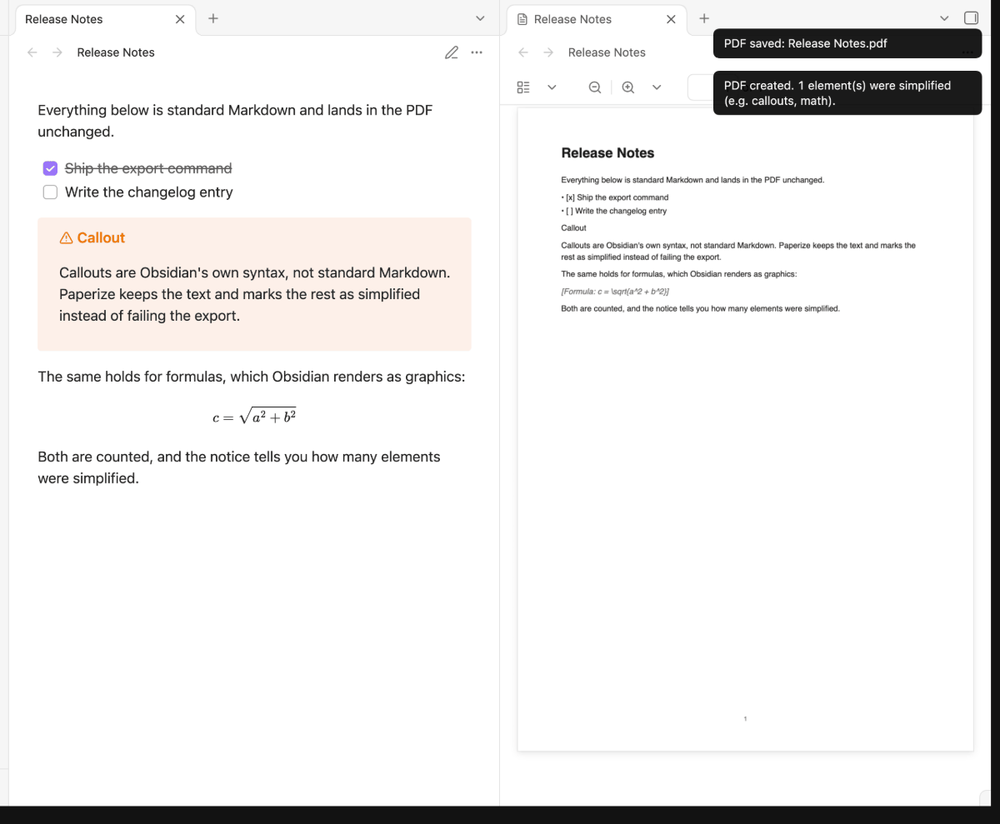

# Paperize – sauberes Markdown → PDF

> [🇬🇧 English](https://github.com/johannes-kaindl/obsidian-paperize/blob/main/README.md) · 🇩🇪 Deutsch

Ein Obsidian-Plugin, das die aktive Notiz als sauberes, textselektierbares **PDF**
exportiert — nur der Inhalt deiner Notiz, sonst nichts. Am Desktop folgt das PDF deinem
Theme, auf iPhone und iPad ist es ein schlichtes Vektor-PDF.

[](https://github.com/johannes-kaindl/obsidian-paperize/blob/main/LICENSE)
[](https://github.com/johannes-kaindl/obsidian-paperize/blob/main/LICENSE-DOCS)
[](https://github.com/johannes-kaindl/obsidian-paperize/releases)
-lightgrey)



## Funktionen

- **Ein Befehl, ein PDF:** **Aktive Notiz als PDF exportieren** ausführen (Befehlspalette
  oder Ribbon-Icon) — die aktive Notiz wird zu einem echten, textselektierbaren
  PDF. Kein Druckdialog des Browsers, kein Screenshot-Umweg.
- **Am Desktop sieht das PDF aus wie deine Notiz.** Callouts behalten ihren Kasten,
  Mermaid-Diagramme und Formeln werden gezeichnet, Schriften und Farben deines Themes
  werden übernommen, die Schriften eingebettet. Zwei Looks: **Papier** (weißer Grund,
  dunkler Text, dünne Linien, spart Tinte, unabhängig von den Farben des Themes; der
  Standard) und **Wie in Obsidian** (das Theme, wie es ist, auch mit dunklem Grund). Siehe
  [Zwei Looks am Desktop](#zwei-looks-am-desktop).
- **Zweisprachige Oberfläche (Deutsch / Englisch):** Befehle, Einstellungen und Hinweise
  folgen automatisch der Anzeigesprache von Obsidian — keine separate Einstellung.
- **Standard-Markdown-Umfang:** Überschriften, Absätze, Bold/Italic/Inline-Code,
  verschachtelte geordnete und ungeordnete Listen, Blockquotes, Trennlinien, Links,
  Bilder (zu JPEG re-encodiert), Codeblöcke und einfache Tabellen.
- **Graceful Degradation, nie ein gescheiterter Export:** Elemente außerhalb dieses
  Umfangs (Callouts, Mathe, Embeds und andere Obsidian-spezifische Renderings) werden
  nicht kommentarlos verworfen, sondern vereinfacht dargestellt (Callouts und Ähnliches als reiner Text, eine Formel als Markierung mit ihrer LaTeX-Quelle) — der
  Export scheitert nie. Eine Zusammenfassungs-Notice nach dem Export zeigt, wie viele
  Elemente vereinfacht wurden, damit du bei Bedarf gegen die Notiz prüfen kannst.
- **Vier Ausgabeziele**, wählbar in den Einstellungen: neben der Notiz (Standard), der
  Obsidian-Anhangordner, ein eigener Ordner, oder Teilen/Öffnen außerhalb des Vaults
  (mobiles Teilen-Menü bzw. Standard-App des Betriebssystems am Desktop).
- **Zwei Ergebnisse, ein Plugin.** Am Desktop lässt Paperize die Browser-Engine von
  Obsidian die Notiz drucken (so sieht sie aus wie die Notiz). Auf iPhone und iPad und
  überall, wo das nicht verfügbar ist, schreibt `main.js` das Vektor-PDF mit der kleinen
  Engine unten selbst (`isDesktopOnly: false`). Scheitert der Desktop-Weg, sagt Paperize es
  in einer Notice und exportiert im einfachen Stil.
- **Zur Laufzeit abhängigkeitsfrei, keine Netzwerkzugriffe, keine Telemetrie.** Der
  PDF-Writer ist eine kleine, pure Engine, vendort unter `src/vendor/kit/pdf/` (aus
  `obsidian-kit@0.8.0`) — keine Drittanbieter-PDF-Bibliothek, kein `fetch`, nichts
  verlässt dein Gerät. Vollständige Erklärung:
  [`SECURITY.de.md`](https://github.com/johannes-kaindl/obsidian-paperize/blob/main/SECURITY.de.md).

## Voraussetzungen

- **Obsidian 1.8.7** oder neuer (das Plugin folgt der Anzeigesprache der App; dafür
  braucht es die `getLanguage()`-API, die es erst ab dieser Version gibt).
- Desktop **und** iPhone/iPad — auf beiden ein echtes PDF; das PDF im Theme-Stil ist ein Desktop-Feature.
- Sonst nichts: keine externe PDF-Bibliothek, kein Netzzugriff, keine Begleit-App.

## Installation

Repository: [github.com/johannes-kaindl/obsidian-paperize](https://github.com/johannes-kaindl/obsidian-paperize)
(Quell-Mirror: [git.jkaindl.de/jkaindl/obsidian-paperize](https://git.jkaindl.de/jkaindl/obsidian-paperize))

### Aus dem Community-Plugins-Browser von Obsidian (empfohlen)

Paperize ist im Community-Plugins-Browser gelistet:

1. **Einstellungen → Community-Plugins → Durchsuchen** öffnen.
2. Nach **„Paperize"** suchen und **Installieren** wählen.
3. Paperize **aktivieren** — keine Konfiguration nötig, die Standardwerte funktionieren
   sofort.

### Von Hand

```bash
# Plugin in den Vault kopieren
cp manifest.json main.js styles.css \
   "<dein-vault>/.obsidian/plugins/paperize/"

# …oder mit gesetztem OBSIDIAN_PLUGIN_DIR:
npm run deploy
```

Oder lade `paperize.zip` aus dem [Release](https://github.com/johannes-kaindl/obsidian-paperize/releases/latest) — es enthält genau diese Dateien (`main.js`, `manifest.json`, `styles.css`) — und entpacke es nach `.obsidian/plugins/`; mit `checksums.sha256` prüfst du den Download.

Dann: Obsidian → Einstellungen → Community-Plugins → neu laden → **Paperize** aktivieren.

## Nutzung

1. Beliebige Markdown-Notiz öffnen.
2. **Aktive Notiz als PDF exportieren** ausführen (Befehlspalette) oder das
   Ribbon-Icon klicken. Am Desktop gibt es zwei weitere Befehle, **… (wie in Obsidian)** und
   **… (Papier)**, die den Look für diesen Export wählen; der erste folgt der Einstellung
   **Aussehen am Desktop**.
3. Das PDF erscheint am konfigurierten Ausgabeziel (siehe **Konfiguration →
   Ausgabeziel** unten). Wurden Elemente beim Export vereinfacht, meldet eine Notice
   die Anzahl.

Der rohe YAML-Frontmatter-Block wird nie gedruckt; standardmäßig erscheinen seine Felder stattdessen als kleine Metadaten-Liste oben (**Frontmatter als Metadaten-Block zeigen**, einstellbar). Die
erste Überschrift (oder der Dateiname, falls keine vorhanden ist) wird zum Titel.

Beginnt die Notiz mit einer **eigenen Überschrift**, bleibt diese stehen und darüber wird
kein zusätzlicher Titel gedruckt — sonst stünde dasselbe zweimal auf Seite eins. Eine Notiz
ohne führende Überschrift bekommt wie bisher ihren Dateinamen als gedruckten Titel.

## Konfiguration

Der Einstellungen-Tab ist in fünf Sektionen gegliedert; **Ausgabe** steht vorn und enthält
Ausgabeziel und Dateiname-Schema.

Ab **Obsidian 1.13** zeichnet Obsidian die Einstellungen selbst — dadurch findet die
Einstellungs-Suche jede Zeile, und die Sektionen erscheinen dort als schlichte
Überschriften. Unter **älteren Versionen** zeichnet das Plugin dieselben Sektionen als
einklappbare Gruppen, mit *Ausgabe* aufgeklappt; die übrigen merken sich, ob du sie offen
gelassen hast.



<a href="https://raw.githubusercontent.com/johannes-kaindl/obsidian-paperize/main/docs/images/settings-all.png"></a><br><sub>Der ganze Tab, alle fünf Sektionen (Klick für Vollansicht)</sub>

| Sektion | Einstellung | Beschreibung | Standard |
| --- | --- | --- | --- |
| Ausgabe | **Ausgabeziel** | Wohin das PDF geschrieben wird: *neben der Notiz*, *Obsidian-Anhangordner*, *eigener Ordner* oder *Teilen/Öffnen außerhalb des Vaults*. | Neben der Notiz |
| Ausgabe | **Eigener Ausgabe-Ordner** | Vault-relativer Ordner, mit Ordnervorschlägen beim Tippen. Nur sichtbar, wenn das Ausgabeziel *eigener Ordner* ist. | *(leer)* |
| Ausgabe | **Aussehen am Desktop** | *Papier* (spart Tinte, unabhängig von den Farben des Themes) oder *Wie in Obsidian* (übernimmt das Theme, auch einen dunklen Hintergrund). Nur am Desktop. | Papier |
| Ausgabe | **PDF nach dem Export öffnen (Standard-App)** | Öffnet die gespeicherte Datei in deiner Standard-PDF-App. Im Modus *Teilen/öffnen* ausgeblendet, der immer öffnet oder teilt. | Aus |
| Ausgabe | **Dateiname-Schema** | Siehe [unten](#dateiname-schema). | `{title}` |
| Seite | **Seitenmaß** | A4 oder Letter. | A4 |
| Seite | **Ränder (mm)** | Seitenrand auf allen vier Seiten, 12–50 mm. | 20 mm |
| Typografie | **Schriftfamilie** | Basis-Schriftart — Sans (Helvetica), Serif (Times) oder Mono (Courier). Nur Adobe-Core-14-Standardschriften, siehe [Schriften](#schriften--die-core-14-grenze) unten. | Sans |
| Typografie | **Schriftgröße (pt)** | Basis-Textgröße, 6–24 pt. Gilt am iPhone und iPad sowie im einfachen Stil. | 10,5 pt |
| Typografie | **Zeilenabstand** | Vielfaches der Schriftgröße, 1,0–2,0. Gilt am iPhone und iPad sowie im einfachen Stil. | 1,45 |
| Typografie | **Maximale Bildbreite (%)** | Anteil der Textbreite, den ein Bild höchstens einnimmt, 25–100 %. | 100 % |
| Inhalt | **Titel oben** | Druckt den Namen der Notiz als Titel über dem Inhalt. Entfällt, wenn die Notiz schon mit einer eigenen Überschrift beginnt — dann ist die Überschrift der Titel. | An |
| Inhalt | **Frontmatter als Metadaten-Block zeigen** | Frontmatter erscheint als dezente Metadaten-Liste oben statt als roher YAML-Block. | An |
| Inhalt | **Seitenzahlen** | Druckt eine Seitenzahl auf jede Seite. | An |
| Inhalt | **Laufende Fußzeile** | Wiederholt Titel und heutiges Datum in der Fußzeile jeder Seite. | Aus |

Die Umbruch-Einstellungen (Seitenumbruch-Marker, Tabellen/Bilder/Code zusammenhalten,
Überschriften-Waisenschutz) liegen in der Sektion **Umbruch**.

### Dateiname-Schema

Standardmäßig heißt das PDF wie die Notiz (`{title}`). Das Schema kennt diese Platzhalter:

| Platzhalter | Bedeutung | Beispiel |
| --- | --- | --- |
| `{title}` | Name der Notiz | `Bericht` |
| `{date}` | Export-Datum | `2026-07-16` |
| `{time}` | Export-Uhrzeit | `1435` |
| `{folder}` | Ordner, in dem die Notiz liegt | `Projekte` |
| `{version}` | Export-Zähler | `1`, `2`, `3` … |

`{date} {title}` ergibt `2026-07-16 Bericht.pdf`. Ein unbekannter Platzhalter bleibt stehen —
so wird ein Tippfehler im Dateinamen sichtbar, statt still zu verschwinden; ein leeres Schema
fällt auf `{title}` zurück.

**Mit `{version}` überschreibst du nichts mehr.** Ohne ihn ersetzt der zweite Export die
vorherige PDF — Paperize fragt vorher nach. Mit ihm zählt jeder Export auf den nächsten freien Namen hoch (`Bericht v1.pdf`,
`Bericht v2.pdf`, …). Im Modus *Anhangordner* ist er wirkungslos — dort löst Obsidian
Kollisionen selbst auf.



## Zwei Looks am Desktop

Am Desktop rendert Paperize deine Notiz so, wie Obsidian sie zeigt, und druckt sie dann mit der
eingebauten Browser-Engine von Obsidian (Chromium). Der Text bleibt markierbar, die Schriften
deines Themes werden eingebettet. Den Look wählst du mit **Aussehen am Desktop** oder per Befehl:

- **Papier** (Standard): weißer Grund, dunkler einfarbiger Text, dünne Linien statt Flächen,
  Links unterstrichen, Diagramme in der hellen Fassung. Ein dunkles Theme kostet nie Tinte.
- **Wie in Obsidian:** das Theme, wie es ist, mit Seitenhintergrund und den Farben von
  Callouts und Code.

Seitenmaß, Ränder, Titel, Metadaten, Seitenzahlen, Fußzeile, Umbruch-Marker und die
Umbruch-Schalter gelten für beide Looks. Seitenzahlen und Fußzeile brauchen Obsidian auf
Chromium 131 oder neuer; auf einer älteren Installation bleibt es beim Theme-Stil, ohne sie,
und Paperize sagt es einmal je Sitzung.

**Wo das geprüft wurde:** macOS mit Obsidian 1.15.1 (Chromium 142) und Linux im Container mit
Obsidian 1.15.0 (Chromium 150), mit dem Theme Field Report hell und dunkel und mit dem
Standard-Theme. **Nicht geprüft:** Windows, Obsidian-Installationen unter Chromium 131,
andere Themes. Der Weg für iPhone und iPad ist unverändert.

## Funktionsweise

Auf iPhone und iPad (und am Desktop als Rückfall) rendert Obsidian die Notiz so, wie es das
immer tut; Paperize wandelt dieses Ergebnis
anschließend in eine kleine, plattformunabhängige Beschreibung der Seite um (Überschriften,
Absätze, Listen, Tabellen, Bilder) und schreibt daraus direkt das PDF — ohne Druckdialog des
Browsers, ohne externe Bibliothek, ohne Netz. Deshalb ist das Ergebnis auf dem Desktop und
unter iOS identisch, und deshalb bleibt der Text markierbar, statt zum Bild von Text zu werden.

Zwei Konsequenzen folgen aus diesem Aufbau, beide bewusst:

- **Was Obsidian als Grafik statt als Text zeichnet** (Formeln), lässt sich nicht als Text
  übernehmen. Paperize markiert die Stelle, statt sie stillschweigend wegzulassen, und zählt
  sie in der Notice nach dem Export mit. Eine Formel steht als `[Formel: E = mc^2]` mit ihrer
  LaTeX-Quelle (nach 120 Zeichen gekürzt), oder als `[Formel]`, wenn die Quelle fehlt. Ein
  Mermaid-Diagramm steht als Quelltext in einem Codeblock im PDF. Ein Callout steht als
  Textzeilen ohne seinen Kasten (den Kasten zeichnet nur der Desktop-Stil).
- **Live-Ansichten** wie Bases- oder Dataview-Blöcke sind kein statisches Markdown; sie
  rendern als Bedienoberfläche und lassen sich in einem Dokument nicht sinnvoll abbilden.

### Standard-Markdown-Umfang & Graceful Degradation

Dieser Abschnitt beschreibt den einfachen Stil (iPhone, iPad, Rückfall). Am Desktop wird
gedruckt, was Obsidian zeichnet, Callouts und Diagramme erscheinen also gezeichnet.

Paperize deckt einen bewusst begrenzten, gut getesteten Markdown-Umfang ab, siehe
**Funktionen** oben. Alles, was Obsidian rendert und außerhalb dieses Umfangs liegt —
Callouts, Mathe-Blöcke, Embeds und andere Plugin- oder Obsidian-spezifische Widgets —
wird nicht kommentarlos verworfen, der Export läuft immer durch. Callouts und Ähnliches
zeigen ihren Textinhalt als reinen Text im PDF; eine Formel ist mit ihrer LaTeX-Quelle
markiert, etwa `[Formel: E = mc^2]`. Nach dem Export meldet eine Notice, wie
viele Elemente auf diese Weise vereinfacht wurden, damit du weißt, wann sich ein
Abgleich mit der Notiz lohnt.



## Schriften & die Core-14-Grenze

Das gilt für den einfachen Stil (iPhone, iPad, Rückfall). Am Desktop bettet das PDF die
Schriften deines Themes ein.

Paperize nutzt ausschließlich die **Adobe-Core-14-PDF-Standardschriften** (die
Helvetica-, Times- und Courier-Familien) — die Schriften, die jeder PDF-Reader ohne
eingebettete Schriftdatei darstellen kann. Das ist eine bewusste Abwägung, kein
fehlendes Feature:

- PDFs bleiben winzig (keine eingebetteten Schriftdaten).
- Keine Custom-Fonts, keine Theme-Schriften, keine nicht-lateinischen Schriften über die
  WinAnsi-Abdeckung hinaus.
- Jedes PDF öffnet identisch in jedem Viewer, auf jeder Plattform.

Wer eingebettete Custom-Fonts oder volle Unicode-Abdeckung braucht, ist bei Paperize an
der falschen Adresse.

## Datenschutz & Sicherheit

Paperize läuft vollständig auf deinem Gerät: keine Netzwerkaufrufe, keine Telemetrie,
kein Tracking. Bilder werden lokal dekodiert und neu kodiert; nichts wird aus dem Web
geladen. Die PDF-Engine ist ein kleines, abhängigkeitsfreies Modul, das ins Plugin
vendort wurde — vollständige Erklärung inklusive Build- und Attestations-Verfahren
(das ausgelieferte `main.js` ist ein esbuild-Bundle aus `src/`, keine committete
Quelldatei — die Attestation deckt das gebaute Artefakt ab) in
[`SECURITY.de.md`](https://github.com/johannes-kaindl/obsidian-paperize/blob/main/SECURITY.de.md).

## Entwicklung

```bash
npm run typecheck   # tsc --noEmit
npm test            # vitest run --passWithNoTests
npm run check:pure  # verweigert 'obsidian'-Imports in src/core + src/vendor
npm run build       # typecheck + esbuild --production → main.js
npm run gate        # typecheck + test + check:pure + build — vor jedem Commit
npm run deploy      # build + cp manifest.json main.js styles.css → $OBSIDIAN_PLUGIN_DIR
```

Architektur-Hinweise und Release-Prozess:
[`AGENTS.md`](https://github.com/johannes-kaindl/obsidian-paperize/blob/main/AGENTS.md).

## Dokumentation

- [Dokumentations-Index](https://github.com/johannes-kaindl/obsidian-paperize/blob/main/docs/README.md) — alle Anleitungen an einem Ort (englisch).
- [Getting started](https://github.com/johannes-kaindl/obsidian-paperize/blob/main/docs/getting-started.md) — von der Installation zum ersten PDF.
- [Troubleshooting](https://github.com/johannes-kaindl/obsidian-paperize/blob/main/docs/troubleshooting.md) — was du siehst, was es bedeutet, was zu tun ist.

## Lizenz

Code: **AGPL-3.0-or-later** — siehe
[`LICENSE`](https://github.com/johannes-kaindl/obsidian-paperize/blob/main/LICENSE).
