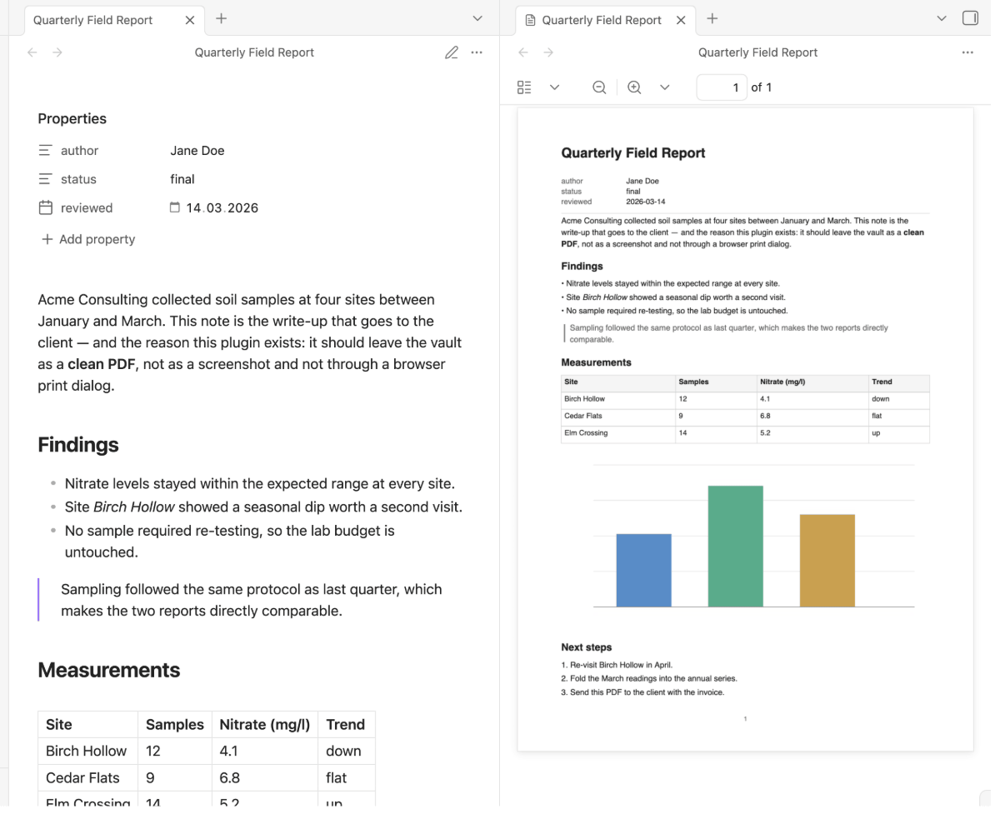
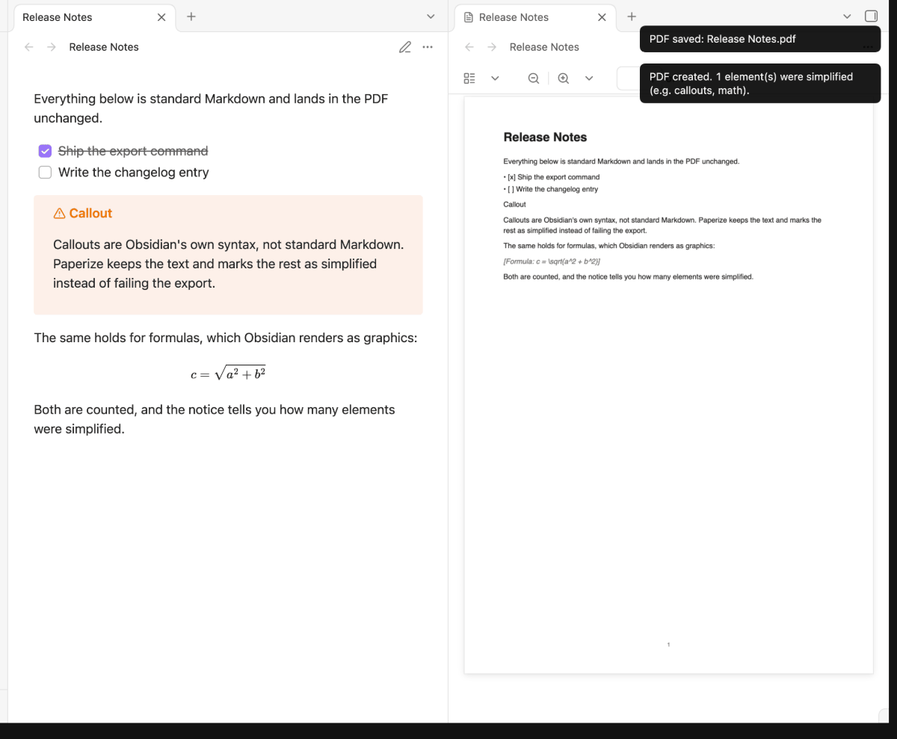
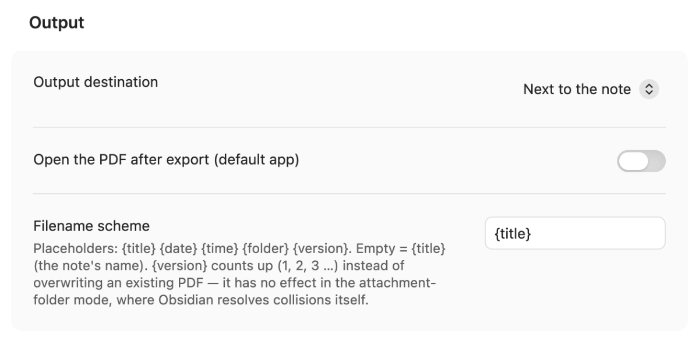
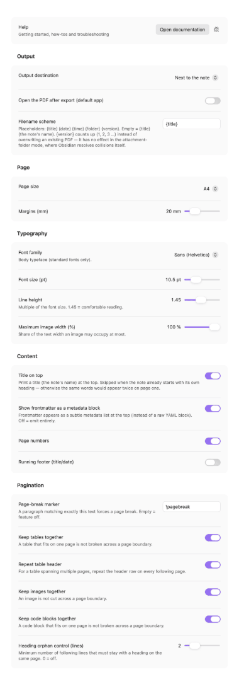
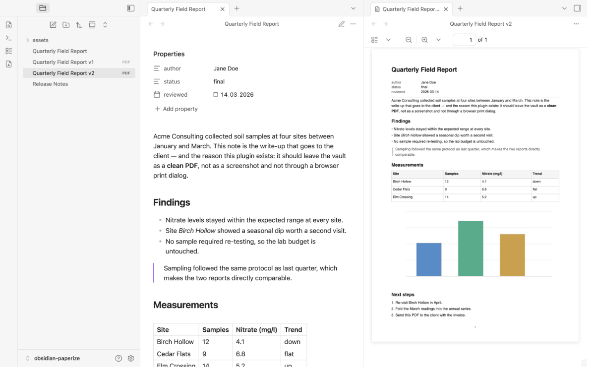

# Paperize – clean Markdown → PDF

> 🇬🇧 English · [🇩🇪 Deutsch](https://github.com/johannes-kaindl/obsidian-paperize/blob/main/README.de.md)

An Obsidian plugin that exports the active note as a clean, text-selectable **PDF**
— just your note's content, nothing added. On desktop the PDF follows your theme; on
iPhone and iPad it is a plain vector PDF.

[](https://github.com/johannes-kaindl/obsidian-paperize/blob/main/LICENSE)
[](https://github.com/johannes-kaindl/obsidian-paperize/blob/main/LICENSE-DOCS)
[](https://github.com/johannes-kaindl/obsidian-paperize/releases)
-lightgrey)



## Features

- **One command, one PDF:** run **Export active note as PDF** (command palette or
  the ribbon icon) and the active note becomes a real, text-selectable PDF — no
  browser print dialog, no screenshot detour.
- **On desktop, the PDF looks like your note.** Callouts keep their box, Mermaid diagrams
  and formulas are drawn, and the fonts and colours of your theme carry over, with the
  fonts embedded. Two looks: **Paper** (white page, dark text, thin lines, saves ink,
  independent of the theme's colours; the default) and **As in Obsidian** (the theme as it
  is, including a dark page). See [Two looks on desktop](#two-looks-on-desktop).
- **Bilingual UI (English / German):** commands, settings, and notices follow your
  Obsidian display language automatically — no separate setting.
- **Standard Markdown scope:** headings, paragraphs, bold/italic/inline code, nested
  ordered and unordered lists, blockquotes, horizontal rules, links, images (re-encoded
  as JPEG), fenced code blocks, and simple tables.
- **Graceful degradation, never a failed export:** on iPhone and iPad (and when the desktop
  path is not available), elements outside that scope (callouts, math, embeds, and other
  Obsidian-specific rendering) are simplified instead of breaking the export: callouts
  and the like become plain text, a formula becomes a marker with its LaTeX source. A single summary notice tells you how many elements were simplified so you can
  check the source note if it matters.



- **Four output destinations**, chosen in settings: next to the note (default), the
  Obsidian attachment folder, a custom folder, or share/open out of the vault (the
  mobile share sheet, or the OS default app on desktop).
- **Two results, one plugin.** On desktop Paperize lets Obsidian's own browser engine print
  the note (so it looks like the note). On iPhone and iPad, and whenever that is not
  available, `main.js` writes the vector PDF itself with the small engine below
  (`isDesktopOnly: false`). If the desktop path fails, Paperize says so in a notice and
  exports in the plain style instead.
- **Dependency-free at runtime, no network, no telemetry.** The PDF writer is a small,
  pure engine vendored under `src/vendor/kit/pdf/` (from `obsidian-kit@0.8.0`) — no
  third-party PDF library, no `fetch`, nothing leaves your device. See
  [`SECURITY.md`](https://github.com/johannes-kaindl/obsidian-paperize/blob/main/SECURITY.md)
  for the full statement.

## Requirements

- **Obsidian 1.8.7** or newer (the plugin follows the app's display language, which needs
  the `getLanguage()` API introduced in that version).
- Desktop **and** iPhone/iPad — a real PDF on both; the theme-style PDF is a desktop feature.
- Nothing else: no external PDF library, no network access, no companion app.

## Install

Repository: [github.com/johannes-kaindl/obsidian-paperize](https://github.com/johannes-kaindl/obsidian-paperize)
(source mirror: [git.jkaindl.de/jkaindl/obsidian-paperize](https://git.jkaindl.de/jkaindl/obsidian-paperize))

### From Obsidian's Community plugins browser (recommended)

Paperize is listed in the Community plugins browser:

1. Open **Settings → Community plugins → Browse**.
2. Search for **"Paperize"** and select **Install**.
3. **Enable** Paperize — no configuration is required to get started; the defaults work
   out of the box.

### Manually

```bash
# Copy the plugin into your vault
cp manifest.json main.js styles.css \
   "<your-vault>/.obsidian/plugins/paperize/"

# …or, with OBSIDIAN_PLUGIN_DIR exported:
npm run deploy
```

Or download `paperize.zip` from the [release](https://github.com/johannes-kaindl/obsidian-paperize/releases/latest) — it contains exactly these files (`main.js`, `manifest.json`, `styles.css`) — and unpack it into `.obsidian/plugins/`; `checksums.sha256` lets you verify the download.

Then: Obsidian → Settings → Community plugins → reload → enable **Paperize**.

## Usage

1. Open any Markdown note.
2. Run **Export active note as PDF** (command palette) or click the ribbon icon. On desktop
   there are two more commands, **… (as in Obsidian)** and **… (paper)**, which pick the look
   for this export; the first one follows the setting **Look on desktop**.
3. The PDF appears at the configured output location (see **Configuration → Output
   destination** below). If any elements were simplified during export, a notice tells
   you how many.

The raw YAML frontmatter block is never printed; by default its fields appear as a small metadata list at the top instead (**Show frontmatter as a metadata block**, configurable). The first
heading (or the note's filename, if there is none) becomes the title.

If the note **starts with its own heading**, that heading stays where it is and no separate
title is printed above it — otherwise the same words would appear twice on page one. A note
without a leading heading gets its filename as the printed title, as before.

## Configuration

The Settings tab is grouped into five sections; **Output** comes first and holds the
destination and the filename scheme.

On **Obsidian 1.13 and later** Obsidian renders the settings itself, which also makes every
row findable through the settings search — the sections appear as plain headings there. On
**older versions** the plugin draws the same sections as collapsible groups, with *Output*
expanded and the rest remembering whether you left them open.



<a href="https://raw.githubusercontent.com/johannes-kaindl/obsidian-paperize/main/docs/images/settings-all.png"></a><br><sub>The whole tab, all five sections (click for full size)</sub>

| Section | Setting | Description | Default |
| --- | --- | --- | --- |
| Output | **Look on desktop** | *Paper* (saves ink, independent of the theme's colours) or *As in Obsidian* (keeps the theme, including a dark background). Desktop only. | Paper |
| Output | **Output destination** | Where the PDF is written: *next to the note*, *Obsidian attachment folder*, *custom folder*, or *share/open out of the vault*. | Next to the note |
| Output | **Custom output folder** | Vault-relative folder, with folder suggestions as you type. Only shown when the destination is *custom folder*. | *(empty)* |
| Output | **Open the PDF after export (default app)** | Opens the saved file in your default PDF app. Hidden in the *share/open* mode, which always opens or shares. | Off |
| Output | **Filename scheme** | See [below](#filename-scheme). | `{title}` |
| Page | **Page size** | A4 or Letter. | A4 |
| Page | **Margins (mm)** | Page margin on all four sides, 12–50 mm. | 20 mm |
| Typography | **Font family** | Body typeface — Sans (Helvetica), Serif (Times), or Mono (Courier). Adobe Core-14 standard fonts only, see [Fonts](#fonts--the-core-14-limitation) below. Applies on iPhone and iPad and to the plain style; on desktop the font comes from the theme. | Sans |
| Typography | **Font size (pt)** | Base body text size, 6–24 pt. Applies on iPhone and iPad and to the plain style. | 10.5 pt |
| Typography | **Line height** | Multiple of the font size, 1.0–2.0. Applies on iPhone and iPad and to the plain style. | 1.45 |
| Typography | **Maximum image width (%)** | Share of the text width an image may occupy at most, 25–100 %. | 100 % |
| Content | **Title on top** | Print the note's name as a title above the content. Skipped when the note already starts with its own heading — the heading is the title then. | On |
| Content | **Show frontmatter as a metadata block** | Frontmatter appears as a subtle metadata list at the top instead of a raw YAML block. | On |
| Content | **Page numbers** | Print a page number on every page. | On |
| Content | **Running footer** | Repeat the title and today's date in the page footer. | Off |

Pagination settings (page-break marker, keeping tables/images/code together, heading orphan
control) live in the **Pagination** section.

### Filename scheme

By default the PDF is named after the note (`{title}`). The scheme accepts these placeholders:

| Placeholder | Meaning | Example |
| --- | --- | --- |
| `{title}` | The note's name | `Report` |
| `{date}` | Export date | `2026-07-16` |
| `{time}` | Export time | `1435` |
| `{folder}` | Folder the note lives in | `Projects` |
| `{version}` | Export counter | `1`, `2`, `3` … |

`{date} {title}` yields `2026-07-16 Report.pdf`. An unknown placeholder is left as-is, so a
typo shows up in the filename instead of silently disappearing; an empty scheme falls back to
`{title}`.

**`{version}` is how you avoid overwriting.** Without it, exporting twice replaces the previous
PDF — Paperize asks before it does. With it, each export counts up to the next free name (`Report v1.pdf`, `Report v2.pdf`, …).
It has no effect in the *attachment folder* mode, where Obsidian resolves collisions itself.



## Two looks on desktop

On desktop, Paperize renders your note the way Obsidian shows it, then prints it with
Obsidian's built-in browser engine (Chromium). The text stays selectable, and the fonts of
your theme are embedded. Pick the look with **Look on desktop** or with the command:

- **Paper** (default): white page, dark single-colour text, thin lines instead of filled
  areas, links underlined, diagrams in their light version. A dark theme never costs you ink.
- **As in Obsidian:** the theme as it is, including the page background and the colours of
  callouts and code.

Page size, margins, title, metadata, page numbers, footer, page-break marker and the
pagination switches apply to both looks. Page numbers and the footer need Obsidian on
Chromium 131 or newer; on an older installation Paperize still uses the theme-style path,
leaves them out and says so once per session.

**Where this was checked:** macOS with Obsidian 1.15.1 (Chromium 142) and Linux in a container
with Obsidian 1.15.0 (Chromium 150), with the Field Report theme in light and dark and with
the default theme. **Not checked:** Windows, Obsidian installations older than Chromium 131,
other themes. The iPhone and iPad path is unchanged.

## How it works

On iPhone and iPad (and as the fallback on desktop), Obsidian renders your note the way it
always does; Paperize then converts that rendered output into a small, platform-independent description of the page (headings, paragraphs,
lists, tables, images) and writes the PDF from it directly — no browser print dialog, no
external library, no network. That is why the result is identical on desktop and on iOS,
and why the text stays selectable rather than becoming a picture of text.

Two consequences follow from this design, and both are deliberate:

- **Anything Obsidian draws as a graphic rather than as text** (formulas) cannot be carried
  over as text. Paperize marks the spot instead of dropping it silently, and counts it in
  the notice you get after export. A formula appears as `[Formula: E = mc^2]` with its LaTeX
  source (cut after 120 characters), or as `[Formula]` when the source is not available.
  A Mermaid diagram appears as its source code, in a code block. A callout appears as plain
  text lines without its box (the box is drawn in the desktop style only).
- **Live views** such as Bases or Dataview blocks are not static Markdown; they render as
  interface chrome and cannot be reproduced meaningfully in a document.

### Standard Markdown scope & graceful degradation

This section describes the plain style (iPhone, iPad, fallback). On desktop, Obsidian's
own rendering is printed, so callouts and diagrams are drawn.

Paperize targets a deliberately bounded, well-tested scope of Markdown, listed under
**Features** above. Anything Obsidian renders that falls outside that scope — callouts,
math blocks, embeds, and other plugin- or Obsidian-specific widgets — is not silently
dropped, and the export always completes. Callouts and similar elements show their text
content as plain text in the PDF; a formula is marked with its LaTeX source, for example
`[Formula: E = mc^2]`. After export, a notice reports how many elements were
simplified this way, so you know when to double-check a note against the PDF.

## Fonts & the Core-14 limitation

This applies to the plain style (iPhone, iPad, fallback). On desktop the PDF embeds the fonts
of your theme.

Paperize uses only the **Adobe Core-14 standard PDF fonts** (the Helvetica, Times, and
Courier families) — the fonts every PDF reader can render without any font file being
embedded in the document. This is a deliberate trade-off, not a missing feature:

- PDFs stay tiny (no embedded font data).
- No custom fonts, no theme fonts, no non-Latin scripts beyond WinAnsi coverage.
- Every PDF opens identically in any viewer, on any platform.

If you need embedded custom fonts or full Unicode coverage, Paperize is not the right
tool for that note.

## Privacy & security

Paperize runs entirely on your device: no network calls, no telemetry, no tracking.
Images are decoded and re-encoded locally; nothing is fetched from the web. The PDF
engine is a small, dependency-free module vendored into the plugin — see
[`SECURITY.md`](https://github.com/johannes-kaindl/obsidian-paperize/blob/main/SECURITY.md)
for the full statement, including how releases are built and attested (the shipped
`main.js` is an esbuild bundle of `src/`, not a committed source file — the attestation
covers the built artifact).

## Development

```bash
npm run typecheck   # tsc --noEmit
npm test            # vitest run --passWithNoTests
npm run check:pure  # refuses 'obsidian' imports in src/core + src/vendor
npm run build       # typecheck + esbuild --production → main.js
npm run gate        # typecheck + test + check:pure + build — run before every commit
npm run deploy      # build + copy manifest.json main.js styles.css → $OBSIDIAN_PLUGIN_DIR
```

See [`AGENTS.md`](https://github.com/johannes-kaindl/obsidian-paperize/blob/main/AGENTS.md)
for architecture notes and release process.

## Documentation

- [Documentation index](https://github.com/johannes-kaindl/obsidian-paperize/blob/main/docs/README.md) — all guides in one place.
- [Getting started](https://github.com/johannes-kaindl/obsidian-paperize/blob/main/docs/getting-started.md) — from the install to your first PDF.
- [Troubleshooting](https://github.com/johannes-kaindl/obsidian-paperize/blob/main/docs/troubleshooting.md) — what you see, what it means, what to do.

## License

Code: **AGPL-3.0-or-later** — see
[`LICENSE`](https://github.com/johannes-kaindl/obsidian-paperize/blob/main/LICENSE).
