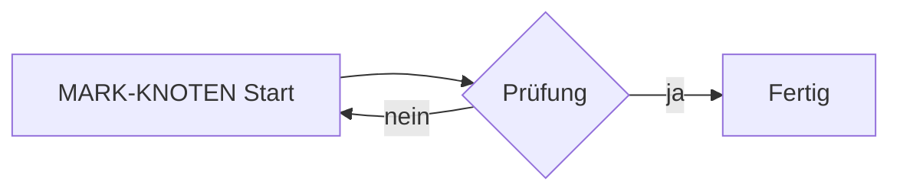

# MARK-H1 Musterdokument im Theme

Dieser Absatz ist Füllstoff für den Umbruch, mit Umlauten wie äöüß und einem **fetten** Wort, einem *kursiven* Wort und `Inline-Code`. Dieser Absatz ist Füllstoff für den Umbruch, mit Umlauten wie äöüß und einem **fetten** Wort, einem *kursiven* Wort und `Inline-Code`. Dieser Absatz ist Füllstoff für den Umbruch, mit Umlauten wie äöüß und einem **fetten** Wort, einem *kursiven* Wort und `Inline-Code`. Dieser Absatz ist Füllstoff für den Umbruch, mit Umlauten wie äöüß und einem **fetten** Wort, einem *kursiven* Wort und `Inline-Code`.

Ein [externer Link](https://example.org) und ein [[Smoke|interner Link]].

## MARK-H2 Callouts

> [!info] MARK-INFO Ein Hinweis
> Inhalt des Info-Kastens mit **Betonung**.

> [!warning] MARK-WARN Eine Warnung
> Inhalt des Warn-Kastens.

> [!tip] MARK-TIP Ein Tipp
> Inhalt des Tipp-Kastens.

## MARK-H2B Diagramm



## MARK-H2C Code und Tabelle

```python
def mark_code():
    return 42
```

| Spalte A | Spalte B |
|---|---|
| MARK-ZELLE | Wert |
| zweite | Zeile |

- [ ] offene Aufgabe
- [x] erledigte Aufgabe

$$E = mc^2$$

![[assets/probe.png]]

## MARK-H2D Fortsetzung

Dieser Absatz ist Füllstoff für den Umbruch, mit Umlauten wie äöüß und einem **fetten** Wort, einem *kursiven* Wort und `Inline-Code`. Dieser Absatz ist Füllstoff für den Umbruch, mit Umlauten wie äöüß und einem **fetten** Wort, einem *kursiven* Wort und `Inline-Code`. Dieser Absatz ist Füllstoff für den Umbruch, mit Umlauten wie äöüß und einem **fetten** Wort, einem *kursiven* Wort und `Inline-Code`. Dieser Absatz ist Füllstoff für den Umbruch, mit Umlauten wie äöüß und einem **fetten** Wort, einem *kursiven* Wort und `Inline-Code`.

Dieser Absatz ist Füllstoff für den Umbruch, mit Umlauten wie äöüß und einem **fetten** Wort, einem *kursiven* Wort und `Inline-Code`. Dieser Absatz ist Füllstoff für den Umbruch, mit Umlauten wie äöüß und einem **fetten** Wort, einem *kursiven* Wort und `Inline-Code`. Dieser Absatz ist Füllstoff für den Umbruch, mit Umlauten wie äöüß und einem **fetten** Wort, einem *kursiven* Wort und `Inline-Code`. Dieser Absatz ist Füllstoff für den Umbruch, mit Umlauten wie äöüß und einem **fetten** Wort, einem *kursiven* Wort und `Inline-Code`.

Dieser Absatz ist Füllstoff für den Umbruch, mit Umlauten wie äöüß und einem **fetten** Wort, einem *kursiven* Wort und `Inline-Code`. Dieser Absatz ist Füllstoff für den Umbruch, mit Umlauten wie äöüß und einem **fetten** Wort, einem *kursiven* Wort und `Inline-Code`. Dieser Absatz ist Füllstoff für den Umbruch, mit Umlauten wie äöüß und einem **fetten** Wort, einem *kursiven* Wort und `Inline-Code`. Dieser Absatz ist Füllstoff für den Umbruch, mit Umlauten wie äöüß und einem **fetten** Wort, einem *kursiven* Wort und `Inline-Code`.

Dieser Absatz ist Füllstoff für den Umbruch, mit Umlauten wie äöüß und einem **fetten** Wort, einem *kursiven* Wort und `Inline-Code`. Dieser Absatz ist Füllstoff für den Umbruch, mit Umlauten wie äöüß und einem **fetten** Wort, einem *kursiven* Wort und `Inline-Code`. Dieser Absatz ist Füllstoff für den Umbruch, mit Umlauten wie äöüß und einem **fetten** Wort, einem *kursiven* Wort und `Inline-Code`. Dieser Absatz ist Füllstoff für den Umbruch, mit Umlauten wie äöüß und einem **fetten** Wort, einem *kursiven* Wort und `Inline-Code`.

Dieser Absatz ist Füllstoff für den Umbruch, mit Umlauten wie äöüß und einem **fetten** Wort, einem *kursiven* Wort und `Inline-Code`. Dieser Absatz ist Füllstoff für den Umbruch, mit Umlauten wie äöüß und einem **fetten** Wort, einem *kursiven* Wort und `Inline-Code`. Dieser Absatz ist Füllstoff für den Umbruch, mit Umlauten wie äöüß und einem **fetten** Wort, einem *kursiven* Wort und `Inline-Code`. Dieser Absatz ist Füllstoff für den Umbruch, mit Umlauten wie äöüß und einem **fetten** Wort, einem *kursiven* Wort und `Inline-Code`.

Dieser Absatz ist Füllstoff für den Umbruch, mit Umlauten wie äöüß und einem **fetten** Wort, einem *kursiven* Wort und `Inline-Code`. Dieser Absatz ist Füllstoff für den Umbruch, mit Umlauten wie äöüß und einem **fetten** Wort, einem *kursiven* Wort und `Inline-Code`. Dieser Absatz ist Füllstoff für den Umbruch, mit Umlauten wie äöüß und einem **fetten** Wort, einem *kursiven* Wort und `Inline-Code`. Dieser Absatz ist Füllstoff für den Umbruch, mit Umlauten wie äöüß und einem **fetten** Wort, einem *kursiven* Wort und `Inline-Code`.
